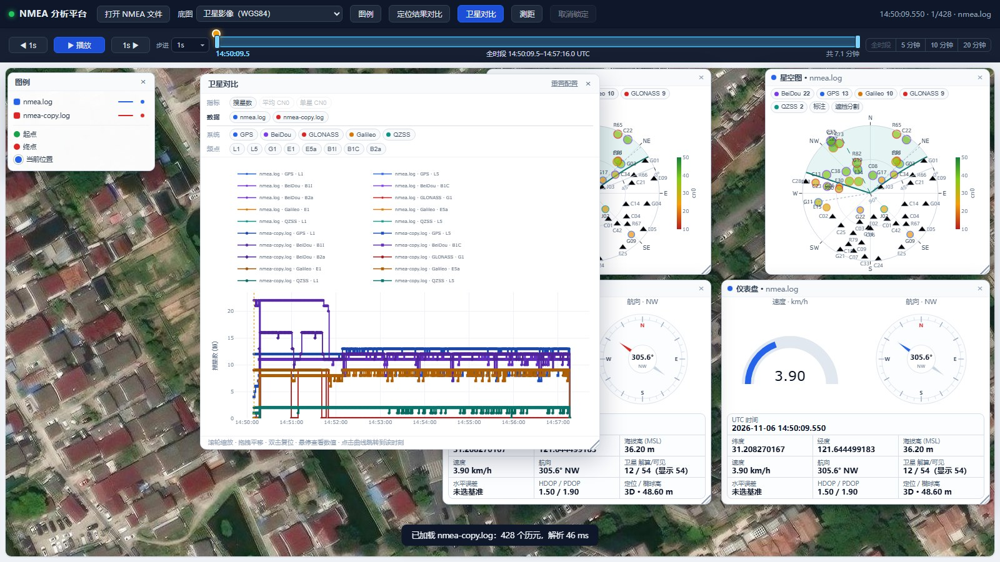

# NMEA 分析平台

NMEA 0183 日志的解析、统计、机器学习与可视化工具集。仓库现在拆成两个**互不依赖**的项目：


| 目录 | 技术栈 | 入口 | 负责 |
|---|---|---|---|
| [`python/`](python/) | Python 3.10+ | 命令行 / 脚本 | NMEA 解析库、CSV/JSON 导出、天空遮挡分割、报告插图 |
| [`web/`](web/) | 原生 JavaScript + Plotly | Node.js 静态服务器 | 浏览器端解析、地图 / 图表 / 全部交互 |

两边没有运行时的代码调用关系：

- Python 不启动网页服务器，也不读写前端源码；
- 前端不调用 Python，不依赖 Python 生成文件才能启动；
- 唯一的可选衔接是 `sky_split.json`：Python 可以导出，前端可以读取；两边都能在没有对方的情况下工作。

## 我该用哪个？

| 想做什么 | 使用 | 入口 |
|---|---|---|
| 看轨迹、星空图、仪表盘、时间轴、对比、卫星对比 | Web | `cd web && npm start` |
| 解析日志、打印摘要、导出 CSV / JSON | Python | `cd python && python analyze_nmea.py nmea.log` |
| 跑天空遮挡分割、生成报告插图 | Python | `cd python && python sky_split.py --print` |
| 把遮挡分割结果叠加到星空图 | Python + Web | 生成 `out/sky_split.json` 后复制到 `web/` |

---

## 方式 1：Web 查看器

### 环境

- Node.js 18+，建议 20+；Google / OSM 的自动代理模式需要 Node.js 24+；
- 不需要 `npm install`，不需要构建；
- Plotly 已内置在 `web/vendor/`。

### 启动

```bash
cd web
npm start
```

如果不想每次开终端：

- **Windows**：双击 `web/start.cmd`；
- **macOS / Linux**：执行 `cd web && ./start.sh`。

脚本会启动本地服务器并自动打开浏览器。

终端会显示地址，默认：

```text
http://127.0.0.1:8000/
```

打开这个地址即可。常用参数：

```bash
npm start -- --port 9000      # 换端口
node server.mjs --open        # 启动并尝试打开浏览器
node server.mjs --host 0.0.0.0 --port 8000
```

### 打开日志

页面默认不加载任何数据，有三种方式：

1. **示例日志**：打开
   `http://127.0.0.1:8000/?file=nmea.log`
2. **自己的日志放在 `web/` 根目录**：
    ```text
    web/
    ├── my_run.log
    ```
    然后访问 `http://127.0.0.1:8000/?file=my_run.log`；
3. **页面里点「打开 NMEA 文件」**，选择本地 `.log` / `.nmea` / `.txt`，支持多选。

页面里的主要操作：

- 地图：滚轮缩放、拖拽平移；拖动当前位置点调整时间；
- 时间轴：拖游标定位、拖两端标尺改时间窗、右侧选 `全时段` / `5 分钟` / `10 分钟` / `20 分钟`；
- 播放：速度由「步进」控制（`1s` 实时、`5s` 5 倍、`1min` 60 倍、`5min` 300 倍、`10min` 600 倍）；
- 地图轨迹点：悬停显示名称 / 时间 / 误差，可「切换此点」或「锁定」；
- 顶栏：`图例`、`定位结果对比`、`卫星对比`、`测距`、`取消锁定`；
- 顶栏「打开 NMEA 文件」支持一次追加多条数据；图例样式浮窗里可逐条改色、隐藏、移除。

### 定位结果对比

顶栏「定位结果对比」可以同时查看多个指标曲线：

- 指标：速度、航向、平均 CN0、卫星数、水平误差；
- 对齐：绝对 UTC / 相对起点；
- 曲线统一使用**实线 + 数据点**，颜色跟随数据集；
- 点击曲线上的点会跳到该时刻，并切换到对应数据；
- 图例在图表上方，支持滚轮缩放、拖拽平移、双击复位。


### 卫星对比

顶栏「卫星对比」打开独立的卫星对比浮窗：

- 配置区按大类排序：**数据 → 系统 → 频点**，数据是第一层大类；
- 指标：搜星数 / 平均 CN0 / 单星 CN0；
- 颜色以**系统色相 + 数据集明暗**为主：
  - GPS 蓝、BeiDou 紫、GLONASS 红、Galileo 橙、QZSS 青；
  - 第一个数据集用基础色，第二个用深色，第三个用浅色；
- 频点用**数据点形状**区分（圆点 / 方块 / 菱形等）；
- 曲线统一使用**实线 + 数据点**，不用虚线；
- 图例在图表上方，按文字宽度自动排列；曲线过多时窗口会自动增高，保证绘图区可见；
- 点击曲线上的点会跳到该时刻并联动地图 / 星空图 / 仪表盘。



> 必须通过 `http://` 打开页面。直接双击 `index.html`（`file://`）时，浏览器会阻止读取示例日志和地图瓦片；Windows 可双击 `web/start.cmd`，macOS / Linux 执行 `web/start.sh`，效果相当于启动本地服务器并自动打开浏览器。

### 停止

在启动服务器的终端按 `Ctrl+C`。

详见 [`web/README.md`](web/README.md)。

---

## 方式 2：Python 命令行分析

### 环境

- Python 3.10+；
- 基础解析只用标准库；
- 天空分割 / 报告需要 `numpy`、`scikit-learn`、`matplotlib`。

```bash
cd python
python analyze_nmea.py nmea.log
```

输出包括：语句统计、起止 UTC、观测时长、历元数、轨迹长度、海拔、可见卫星、星座分布等。

导出数据：

```bash
# 历元级 CSV
python analyze_nmea.py nmea.log --csv out/epochs.csv

# 卫星级 CSV
python analyze_nmea.py nmea.log --sky-csv out/sky.csv

# 完整 JSON + 摘要
python analyze_nmea.py nmea.log --json out/nmea.json --summary-json out/summary.json
```

详见 [`python/README.md`](python/README.md)。

---

## 方式 3：天空遮挡分割

```bash
cd python
pip install -r requirements.txt

python sky_split.py --print
```

产物：

```text
python/out/sky_split/
├── summary.json
├── satellites.csv
├── labels.csv
├── curves.csv
└── feature_ablation.json
python/out/sky_split.json     # 可选的查看器叠加数据
```

生成报告插图：

```bash
python make_sky_report.py
python make_sky_report.py --only 5
```

完整报告：[`python/sky_split.md`](python/sky_split.md)。

---

## 两个项目如何交换数据（可选）

默认不需要交换。如果希望 Web 的星空图显示遮挡分割叠加：

```bash
cd python
python sky_split.py --print
```

然后把：

```text
python/out/sky_split.json
```

复制为：

```text
web/sky_split.json
```

Windows PowerShell：

```powershell
Copy-Item python\out\sky_split.json web\sky_split.json
```

- Web 没有 `sky_split.json` 时会自动降级为普通星空图，其他功能不受影响；
- 该文件必须与当前日志的历元数 / 时间匹配，否则 Web 会自动关闭叠加；
- 这是**文件级、可选的**衔接，不是运行时依赖。

---

## 目录

```text
.
├── python/                 # Python 离线工具
│   ├── nmea_parser.py
│   ├── analyze_nmea.py
│   ├── sky_split.py
│   ├── make_sky_report.py
│   ├── tests/
│   ├── docs/sky/
│   ├── nmea.log
│   ├── requirements.txt
│   └── README.md
├── web/                    # 独立 JavaScript 查看器
│   ├── index.html
│   ├── app.js
│   ├── style.css
│   ├── server.mjs
│   ├── package.json
│   ├── start.cmd           # Windows 双击启动
│   ├── start.sh            # macOS / Linux 启动
│   ├── nmea.log
│   ├── sky_split.json      # 可选演示数据
│   ├── vendor/
│   ├── docs/
│   └── README.md
├── docs/                   # 仓库级截图
├── task*.md                # 任务记录
└── README.md
```

---

## 验证

```bash
# Python
cd python
pip install -r requirements.txt
python -m unittest discover -s tests -v

# Web（另开终端）
cd web
npm start
```

---

## 常见问题

**Q: `python serve.py` 还能用吗？**
不能。旧的 `serve.py` 已删除，Web 统一用 `cd web && npm start`；Python 不再提供网页服务。

**Q: `npm start` 端口被占用？**
`npm start -- --port 9000`，或 `node server.mjs --port 9000`。

**Q: 页面打开后地图是空白的？**
地图底图需要网络。ArcGIS / 高德默认可用；Google / OSM 在部分网络需要代理。`web/server.mjs` 启动时会自动检测 `HTTPS_PROXY` / `HTTP_PROXY` 和 Windows 系统代理（含 PAC）（需要 Node.js 24+），检测到后会以代理模式重启，直接双击 `start.cmd` 也可以。也可以显式指定：

```bash
cd web
node server.mjs --proxy http://127.0.0.1:1080
```

**Q: 页面能否直接用 `file://` 打开？**
不能获得完整功能：浏览器会阻止页面读取本地日志、`sky_split.json` 和地图瓦片。要“像双击应用一样”打开，Windows 双击 `web/start.cmd`，macOS / Linux 执行 `web/start.sh`；它们会启动本地服务器并自动打开浏览器。

**Q: 只做解析，需要装依赖吗？**
不需要。`analyze_nmea.py` 和 `nmea_parser.py` 只用标准库；只有天空分割 / 报告需要 `requirements.txt` 里的包。
