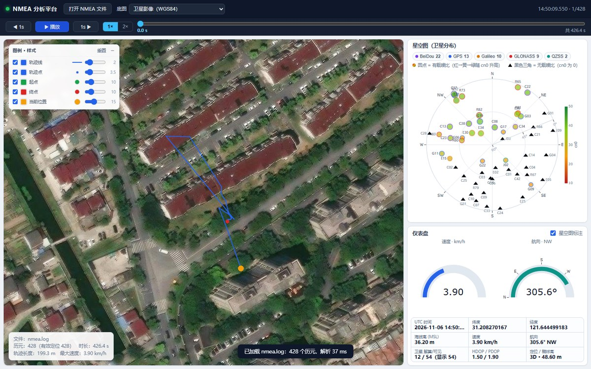

# NMEA 分析工具

对 GNSS 接收机记录的 NMEA 0183 日志做解析、统计与可视化。包含三部分：

- **task1** — Python 解析库 + 命令行分析脚本，输出时间、经纬度、高度、速度、航向、卫星信息，可导出 CSV / JSON。
- **task2** — HTML + JavaScript + Plotly 的展示分析平台：左侧地图轨迹，右上星空图，右下仪表盘。
- **task3** — 无监督的天空遮挡分割：从卫星可见性、跟踪状态与 cn0 中识别建筑遮挡方位，输出两条边界曲线、逐星直射概率，并做时间窗抖动与旋转增强实验。报告见 [`sky_split.md`](sky_split.md)。

仓库自带的示例数据是 `nmea.log`（多星座 GNSS 日志，428 个历元，约 426 秒）。




## 目录

```
analyze_nmea.py      命令行分析脚本（task1）
nmea_parser.py       NMEA 0183 解析库（仅标准库）
sky_split.py         天空遮挡分割算法 + CLI（task3，依赖 numpy / scikit-learn）
make_sky_report.py   重新生成 sky_split.md 的全部插图（task3）
sky_split.md         天空遮挡分割实验报告（task3）
tests/               解析库与分割算法的单元测试
serve.py             本地服务器：静态文件 + 地图瓦片代理
web/index.html       展示平台页面
web/app.js           前端解析与绘图逻辑
web/style.css        样式
web/sky_split.json   星空图遮挡分割叠加数据（由 sky_split.py 生成）
web/vendor/          Plotly（本地副本，离线可用）
docs/                README 截图
docs/sky/            sky_split.md 的插图
nmea.log             示例日志
```

## task1：命令行分析

```bash
python analyze_nmea.py nmea.log
```

输出示例（摘要）：

```
语句行数      : 13908
有效语句      : 13895
语句类型      : GSV×10203, GSA×1547, VTG×429, DTM×429, RMC×429, GNS×429, GGA×429
起始时刻 (UTC): 2026-11-06T14:50:09.550
观测时长      : 426.450 s
历元数        : 428 (有效定位 428)
轨迹长度      : 199.3 m
海拔高        : 14.40 ~ 91.30 m (均值 49.68)
可见卫星      : 38 ~ 54 (均值 44.2)
星座分布      : BeiDou 22 颗, GLONASS 9 颗, GPS 13 颗, Galileo 10 颗, QZSS 2 颗
```

导出数据：

```bash
# 历元级 CSV：时间、经纬度、海拔、椭球高、速度、航向、DOP、星数
python analyze_nmea.py nmea.log --csv out/epochs.csv

# 卫星级 CSV：每个历元每颗星的仰角/方位角/cn0
python analyze_nmea.py nmea.log --sky-csv out/sky.csv

# 完整 JSON（含卫星明细）与统计摘要
python analyze_nmea.py nmea.log --json out/nmea.json --summary-json out/summary.json
```

只依赖 Python 3.10+ 标准库，无需安装第三方包。

### 解析库用法

```python
from nmea_parser import parse_file, summarize

result = parse_file("nmea.log")
epoch = result.epochs[0]
print(epoch.datetime_iso, epoch.lat, epoch.lon, epoch.altitude, epoch.speed_kmh)
print(epoch.course, epoch.num_sats_used, epoch.hdop, epoch.fix_label)
for satellite in epoch.satellite_list():
    print(satellite.system, satellite.prn, satellite.elevation, satellite.azimuth, satellite.cn0)

print(summarize(result))
```

支持的语句：`RMC`、`GGA`、`GNS`、`VTG`、`GSA`、`GSV`、`DTM`（DTM 仅做识别统计）。
通过 talker 前缀识别星座：`GP` GPS、`GL` GLONASS、`GA` Galileo、`GB/BD` BeiDou、`GQ` QZSS、`GN` 多系统。

处理规则：

- 逐句校验 NMEA 校验和，默认丢弃校验失败的语句（`--no-strict-checksum` 可保留）。
- 历元以 `RMC`/`GGA`/`GNS` 的 UTC 时间为锚点；`GSV` 归入其之前最近的历元，`GSA`/`VTG` 归入其之后最近的历元。
- 同一历元内重复播报的同一颗卫星按信息完整度去重（优先保留有 cn0 的记录）。
- 经纬度按 `ddmm.mmmm` 解析，南纬/西经取负；海拔高为 MSL，椭球高 = MSL + 大地水准面差距。

### 测试

```bash
python -m unittest discover -s tests -v
```

## task2：展示平台

```bash
python serve.py            # 打开 http://localhost:8000/
python serve.py --open     # 顺便拉起浏览器
python serve.py --port 9000
python serve.py --proxy http://127.0.0.1:1080   # Google / OSM 需要代理时
```

Google / OSM 瓦片在部分网络（尤其大陆）无法直连。`serve.py` 启动时会自动读取 `HTTPS_PROXY` / `HTTP_PROXY` 等环境变量或 Windows 系统代理设置（含 PAC），**只让 Google / OSM 走代理**，ArcGIS / 高德仍直连；启动日志会打印检测结果。也可以显式指定 `--proxy`，或用 `--no-proxy` 关闭自动代理。

页面布局：

- **左侧地图**：轨迹画成连线 + 历元点，起点（绿）、终点（红）、当前位置（橙）。底图可在顶栏切换。
  - 支持**多条数据同时显示**：每条轨迹使用自己的颜色，图例里可以逐条显示/隐藏、改颜色、移除，点文件名切换星空图 / 仪表盘的当前数据；默认配色按加入顺序分配（蓝、红、绿、橙、紫……），同名文件重新载入时沿用上次的颜色和显隐，设置保存在浏览器 `localStorage`。
  - 左上角「图例 · 样式」的下半部分可以统一调整轨迹线宽度、轨迹点大小、起点/终点/当前位置的大小与颜色（轨迹线、轨迹点、当前位置的颜色跟随各自数据集）；「重置」恢复默认值。
  - 鼠标滚轮缩放、按住左键拖拽平移；缩放范围按底图可用瓦片级别限制（ArcGIS 19 级、高德 18 级、Google 20 级）。
  - 手动调整的视野会保留：拖动轨道游标、播放、切换底图都不会把镜头拉回初始位置；高德与影像之间切换时自动做 GCJ-02 换算，位置不漂移。
- **右上星空图**：卫星按方位角（0°=北，顺时针）与仰角（圆心=天顶）投影到极坐标。
  - 圆点 = 有载噪比，颜色从红（低）经黄到绿（高），见右侧 cn0 色标；点的大小也随 cn0 变化。
  - 黑色三角 = 无载噪比（cn0 为 0 或缺失）。
  - 点外圈颜色区分星座，星座 chips 可按星座过滤。
- **右下仪表盘**：速度表 + 航向指南针（固定 N/E/S/W 罗盘，指针按航向旋转，中心显示度数与方位）+ 时间/经纬度/海拔/速度/航向/星数/DOP/定位质量读数。
- 顶部控制条：播放/暂停、`◀ 1s` / `1s ▶` 前后跳 1 秒、`1×` / `2×` 倍速，以及一条把**进度条与时间窗条合二为一**的轨道（时间轴始终按**绝对 UTC** 合并，多份数据按真实时间排在同一条轴上）。
  - 整条轨道就是全部时间：橙色游标是当前时刻，高亮窗口是时间窗，窗内亮色一段是已播放进度。
  - 时间窗条的读数、手柄提示和游标提示都用 UTC 时刻（如 `全时段 14:50:09.5–14:57:16.0 UTC`）；跨度跨天时自动补上 `MM-DD`，数据没有 UTC 时间戳时才回退为相对秒。
  - 拖游标（或点击轨道任意位置）定位当前时刻；点到的位置在窗口外时，窗口保持窗宽跟过去（居中），所以进度条仍能跳到任意时间。
  - 拖左标尺改开始时间、拖右标尺改结束时间、拖窗口中间整体平移；窗口中间点一下不拖则是定位。聚焦标尺后方向键可微调（`1 s`，`Shift` 为 `10 s`）。
  - 右侧是时间窗预设按钮：`全时段` 恢复默认，`5 分钟` / `10 分钟` / `20 分钟` 以当前时刻为中心取固定窗宽（贴边时整体平移、不压缩窗宽；数据本身不够长时退化为全时段并提示实际时长）。
  - 时间窗会约束播放范围（播到右端即停，当前时刻在窗外时从起点开始）、游标定位范围、对比曲线的 x 轴显示范围，并让地图上的轨迹线与轨迹点只显示窗口内的时间段。
  - 装载 / 移除数据时时间域按绝对 UTC 扩展或收缩，时间窗按绝对时间整体平移（不按比例缩放），窗口本来就等于全时段则仍保持全时段。
- 播放按真实时间推进：1× 表示 1 秒数据用 1 秒播放，2× 为两倍速；到末尾自动停止。
- 页面每帧同步地图、星空图与仪表盘；多条数据时，所有轨迹的「当前位置」按同一个时间点一起移动。

### 浮窗与多数据对比

- **浮窗**：星空图和仪表盘标题栏右上角的 `⧉` 按钮把它们变成浮窗——可拖动标题栏移动、拖右下角缩放、尺寸与位置写入 `localStorage`，刷新后保持；再点一次还原到侧栏（侧栏保留占位）。
- **多条数据**：一次可以选择或拖入多个 `.log` / `.nmea` / `.txt` 文件，每次追加一条轨迹，已有数据不会被覆盖。
- **对比曲线**：顶栏「对比曲线」打开浮窗，可配置
  - 指标：速度、航向、平均 cn0、卫星数（可多选，每个指标一张对齐 x 轴的子图）；
  - 对齐：`相对起点`（每条数据从自己的起点开始，跨日期也能比）/ `绝对 UTC`（按真实时间对齐，适合同一天多次采集）。**只影响对比曲线的 x 轴**，时间轴与时间窗始终按绝对 UTC；
  - 数据：参与对比的数据集（默认全选）。

  曲线上悬停显示数值；点击任意曲线上的点会跳到该时刻，并把该数据设为当前数据，地图、星空图、仪表盘一起联动。指标与对齐方式保存在 `localStorage`，「重置配置」恢复默认。
- 时间轨道与播放按绝对 UTC 覆盖全部数据的最早到最晚时刻，每条数据按自己的 UTC 时间轴定位到最近历元。
- 时间窗只改「看哪一段」，不改数据本身：地图上的轨迹线与轨迹点只画窗口内的时间段（窗口外不绘制，起点/终点标记仍按整条数据标出），窗口外的曲线也仍可手动平移图表看到。
- 时间跨度不一致时，焦点数据在当前时刻越界（早于起点或晚于末尾）不会停在端点帧冒充「当前值」：顶部标签变黄提示越界与覆盖区间，仪表盘与星空图切为空数据态并给出说明，地图上该轨迹的「当前位置」点也同时隐藏；回到覆盖范围内自动恢复。切换聚焦数据时标签、读数、仪表盘、星空图一起刷新。

交互：

- 点击「打开 NMEA 文件」或直接把 `.log` / `.nmea` / `.txt` 文件拖进页面（可多选、可一次拖入多个）。
- 顶栏「底图」切换卫星影像 / 高德街道 / 高德卫星 / Google 卫星（Earth）/ Google 街道 / OSM / 无底图。
- 空格键播放/暂停，`←` `→` 后退/前进 1 秒，`Esc` 关闭对比浮窗。
- 链接参数 `?base=gaode-street` 可指定默认底图（也支持 `?base=google-satellite`、`?base=google-street`）。
- 页面默认不加载任何数据：把 `.log` / `.nmea` / `.txt` 拖进页面，或点「打开 NMEA 文件」即可开始。也可以给链接加 `?file=nmea.log`（换成仓库根目录下其它日志文件名亦可）让页面打开时自动加载这一份，方便分享或复盘。`serve.py` 会提供根目录下的这些文件（仅限根目录直接子文件）。

### 底图与坐标系

| 底图 | 坐标系 | 处理 |
| --- | --- | --- |
| 卫星影像（ArcGIS World Imagery） | WGS84 | 直接使用 |
| 高德街道 / 高德卫星 | GCJ-02 | 前端做 WGS84 → GCJ-02 纠偏，否则会偏移约 400 m |
| Google 卫星（Earth，`lyrs=s`）/ Google 街道（`lyrs=m`） | GCJ-02 | 瓦片带 `gl=cn`，与大陆 GCJ-02 路网一致；前端同样做纠偏 |
| OpenStreetMap | WGS84 | 直接使用 |

地图瓦片通过 `serve.py` 的 `/tiles/{source}/{z}/{x}/{y}` 代理获取（同时解决 CORS 与 ArcGIS 的 `{z}/{y}/{x}` 顺序问题），并缓存在 `.cache/tiles`。因此页面必须经由 `serve.py` 打开，直接用 `file://` 无法加载数据与底图。Google 卫星 / 街道底图请求的是 `mt1.google.com` 的 `lyrs=s` / `lyrs=m` 瓦片，代理层带 `gl=cn` 与浏览器 UA；这两个源和 OSM 在检测到代理时走代理，其余源直连。

> Google / OSM 底图空白时，先看 `serve.py` 的启动日志：显示「代理: 未检测到」就需要先启动代理客户端或用 `--proxy` 指定；控制台出现 `[tile] 失败 google-... timed out` 表示对应域名在当前网络不可达，与前端无关。

`web/app.js` 内含一份与 `nmea_parser.py` 行为一致的解析实现，所以浏览器端不需要 Python 也能解析日志文件（只有瓦片代理依赖 `serve.py`）。

## task3：天空遮挡分割

从 `GSV` 的“方位 / 仰角 / cn0 / 是否跟踪到”出发，无监督地判断哪一片天空被建筑挡住，并给出两条边界曲线。详细推导、关键数据与全部插图见 [`sky_split.md`](sky_split.md)。

```bash
python sky_split.py --print       # 分析 nmea.log，写 out/sky_split/* 与 web/sky_split.json
python make_sky_report.py         # 重新生成 docs/sky/*.png
python make_sky_report.py --ablation   # 顺便跑特征消融实验
```

算法四步（全部无监督，不含决策树类模型）：

1. **整体朝向**：把每颗星压成 `(平均方位, 平均 cn0)`，遍历 `(φ0, w)` 用两类间方差找最强信号带，得朝向 **332.8°**、半宽 **71.6°**。
2. **强星 PCA**：对 Otsu 阈值以上的 23 颗强星做 3 维单位向量主成分分析，`sin(w)=√3·σ1` 得半宽 **72.7°**，与扫描相差 1.1°。
3. **GMM 分类**：对每条“卫星 × 历元”取当前 1 s / 过去 5 s / 过去 10 s 窗口的 `[cn0 峰值, cn0 均值]`，用 2 分量高斯混合（tied 协方差）输出 p(直射)；整窗未跟踪的样本按物理先验直接判非直射。
4. **两条边界曲线**：在 `W(el)=a+b·el/90` 上做二维搜索最小化误分星数，得西边界 72.0°、东边界 74°→69°，直射区方位 **260.8°→46.8°**、占天空 **40.0%**。

实验结论：

| 实验 | 结论 |
| --- | --- |
| 时间窗（1 s / 5 s / 10 s） | 硬标签翻转 **601 → 120 → 92** 次；相邻历元掩膜 IoU **0.954 → 0.994**；边界逐历元变化 **3.3° → 0.41°** |
| 旋转增强（每 10°，36 组） | 朝向误差 **0.00°**、带宽标准差 **0.00°**、去旋转掩膜 IoU **1.000**；亚度偏移同样为 0 |
| 无标签校验 | 从未跟踪到的 8 颗星 p=0，全程强信号的 6 颗星 p=0.996，极值准确率 **99.98%** |

网页端的联动：星空图上会叠加青色直射带（两条边界曲线之间）、灰色点线（全程估计）、以及“有载噪比但判为非直射”的红圈；面板右上角「遮挡分割」可开关。分割数据由 `sky_split.py` 写入 `web/sky_split.json`，找不到或历元数不匹配时页面自动退回纯星空图。

## 已知限制

- Plotly 3 对 `mapbox` 系列 trace 给出弃用提示（建议迁移到 `map` + MapLibre）。当前实现仍使用 `scattermapbox`，功能正常；浏览器控制台会出现一条弃用警告，以及 Plotly 内部在底图 style 加载期触发的 `Style is not done loading`（每次重建地图各一条，加载多条数据时会有多条），均不影响渲染。
- 多数据集对比不做时间重采样：每条数据按自己的历元独立定位，图上相邻两点之间是直线段；采样率差异很大时，曲线密度会不一样。
- ArcGIS World Imagery 在 20 级及以上无瓦片，高德瓦片最高 18 级，Google 瓦片最高 20 级，因此地图缩放上限按底图分别限制。
- Google 底图使用其未公开的瓦片接口（`mt1.google.com/vt/lyrs=...`），该接口在部分网络不可直连；`serve.py` 检测到代理时会自动使用，没有可用代理时底图会空白（瓦片代理返回 502）。这类接口也可能随时变更或停用，且受 Google 服务条款约束，建议只在本地个人分析时使用。
- OSM 与 Google 类似，在部分网络不可直连，`serve.py` 会按同一套代理设置访问；未检测到代理时同样可能返回 502。ArcGIS 已停用 World_Street_Map / World_Topo_Map 的瓦片返回，故未采用。
