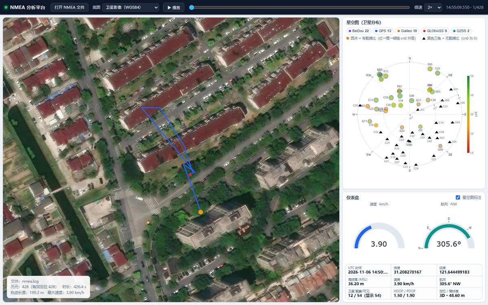
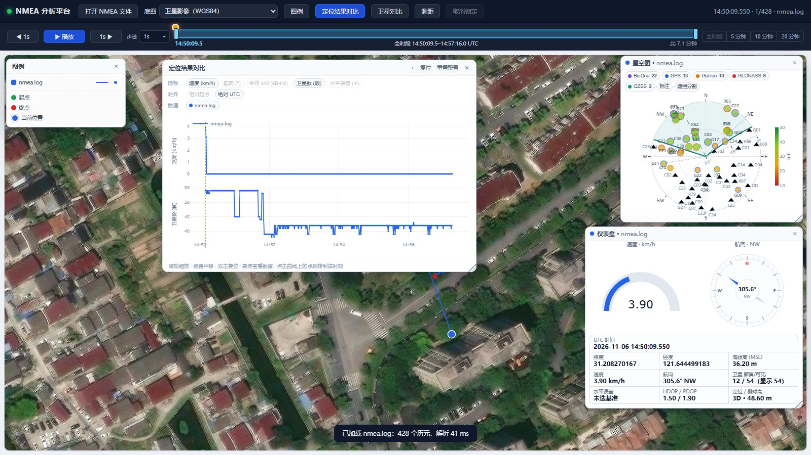
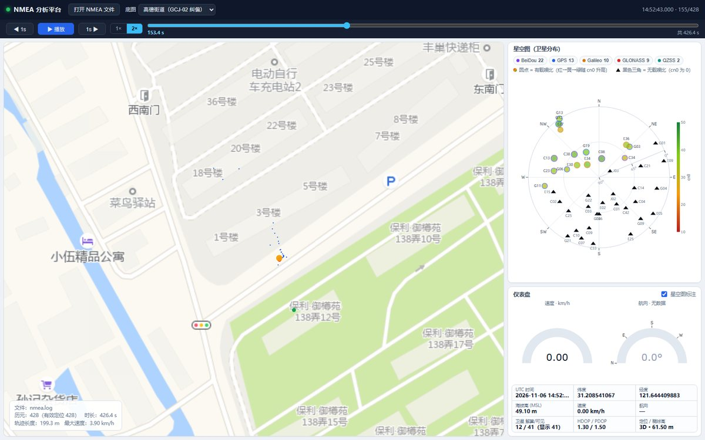

# NMEA 分析平台

对 GNSS 接收机记录的 NMEA 0183 日志做解析、统计与可视化。仓库包含三部分：

- **task1 — Python 解析与命令行分析**：零依赖解析库 + CLI，输出时间、经纬度、高度、速度、航向、卫星信息，可导出 CSV / JSON。
- **task2 — 浏览器展示平台**：纯静态 HTML + JavaScript + Plotly。地图轨迹、每条轨迹一套星空图 / 仪表盘浮窗、统一绝对 UTC 时间轴与时间窗、定位结果对比、卫星对比、水平误差基准、多底图切换。
- **task3 — 天空遮挡分割**：从卫星可见性、跟踪状态与 cn0 中无监督识别建筑遮挡方位，输出两条边界曲线与逐星直射概率，并做时间窗抖动与旋转增强实验。报告见 [`sky_split.md`](sky_split.md)。

仓库自带的示例数据是 `nmea.log`（多星座 GNSS 日志，428 个历元，约 426 秒）。



## 快速开始

只需要 Python 3.10+。task1 只用标准库；task3 需要 `numpy` / `scikit-learn`；展示平台不需要构建步骤（Plotly 已内置在 `web/vendor/`）。

```bash
# 1. 命令行分析（零依赖）
python analyze_nmea.py nmea.log

# 2. 启动展示平台
python serve.py --open        # 打开 http://localhost:8000/

# 3. 运行单元测试
python -m unittest discover -s tests -v

# 4. 可选：天空遮挡分割
python sky_split.py --print
python make_sky_report.py
```

> 展示平台必须经由 `serve.py` 打开（`http://localhost:8000/`）。直接以 `file://` 打开时，浏览器会阻止读取本地日志文件与地图瓦片。

## 功能概览

**解析与分析**

- 支持 `RMC`、`GGA`、`GNS`、`VTG`、`GSA`、`GSV`、`DTM`，按 talker 前缀识别 GPS / GLONASS / Galileo / BeiDou / QZSS / 多系统。
- 逐句校验和、重复卫星去重、`GSV` / `GSA` 按时间就近归入历元。
- 历元级 / 卫星级 CSV、完整 JSON 与统计摘要导出。

**展示平台**

- 地图轨迹：起点（绿）、终点（红）、当前位置（轨迹色圆点），轨迹点形状可选圆点 / 方块 / 三角 / 菱形 / 星形 / 十字 / 叉号；滚轮缩放、拖拽平移，底图可切换。悬停普通轨迹点显示名称 / 时间 / 水平误差并可以锁定。
- 多数据：一次载入多份日志，按颜色区分，可逐条显示 / 隐藏 / 改色 / 移除，每条数据的线宽、点大小和点形状也可以分别设置。
- 每条轨迹独立的星空图与仪表盘浮窗，可打开 / 关闭 / 拖动 / 缩放，位置与尺寸持久化。
- 统一时间轴：进度条与时间窗合二为一，按绝对 UTC 显示，支持 `全时段` / `5 分钟` / `10 分钟` / `20 分钟` 预设。
- 定位结果对比：速度 / 航向 / 平均 cn0 / 卫星数 / 水平误差，可按绝对 UTC 或相对起点对齐，支持滚轮缩放、拖拽平移、双击复位。
- 水平误差基准：在图例样式浮窗里选一条数据作基准，其他轨迹按同一时刻与基准位置的水平距离对比。
- 图例样式 / 图例浮窗：均可拖动；图例样式浮窗可缩放，顶栏「图例」按钮开关，图例内容由样式浮窗里的勾选控制。
- 地图上的当前位置点可以直接拖动来调整时间，悬停 / 拖动时显示该点的 UTC 时间。
- 轨迹点悬停卡片：显示数据集名、UTC 时间、水平误差（有基准时）和「切换此点」「锁定」；「切换此点」把当前时刻切到该点，锁定后卡片固定在该点并随地图平移/缩放，可点「取消」移除。顶栏「取消锁定」清空全部锁定。
- 测距：顶栏「测距」打开紧凑的悬浮窗，在地图上点选两点或多点，逐段距离和总长直接标在图上，支持撤销 / 清除 / 完成。
- 播放：`1×` / `2×` 倍速，按真实时间推进，到时间窗右端自动停止。

**天空遮挡分割**

- 无监督朝向估计、强星 PCA、GMM 直射分类、双边界曲线拟合。
- 时间窗抖动与旋转增强实验，验证算法的稳定性。
- 星空图叠加直射带、全程边界与「有信号但判为非直射」的红圈。

## 项目结构

| 路径 | 说明 |
| --- | --- |
| `nmea_parser.py` | NMEA 0183 解析库（仅标准库） |
| `analyze_nmea.py` | 命令行分析脚本，导出 CSV / JSON |
| `sky_split.py` | 天空遮挡分割算法 + CLI（依赖 numpy / scikit-learn） |
| `make_sky_report.py` | 重新生成 `sky_split.md` 的全部插图 |
| `sky_split.md` | 天空遮挡分割实验报告 |
| `serve.py` | 本地服务器：静态文件 + 地图瓦片代理 |
| `web/index.html` | 展示平台页面 |
| `web/app.js` | 浏览器端解析、绘图与交互逻辑 |
| `web/style.css` | 页面样式 |
| `web/sky_split.json` | 星空图遮挡分割叠加数据（由 `sky_split.py` 生成） |
| `web/vendor/` | Plotly 本地副本，离线可用 |
| `tests/` | 解析库与分割算法的单元测试 |
| `docs/` | README 截图 |
| `docs/sky/` | `sky_split.md` 的插图 |
| `nmea.log` | 示例日志 |

## task1：Python 解析与命令行分析

```bash
python analyze_nmea.py nmea.log
```

输出示例（摘要）：

```
语句行数      : 13908
有效语句      : 13895
语句类型      : GSV×10203, GSA×1547, VTG×429, DTM×429, RMC×429, GNS×429, GGA×429
起始时刻 (UTC): 2026-11-06T14:50:09.550
观测时长      : 426.450 s
历元数        : 428 (有效定位 428)
轨迹长度      : 199.3 m
海拔高        : 14.40 ~ 91.30 m (均值 49.68)
可见卫星      : 38 ~ 54 (均值 44.2)
星座分布      : BeiDou 22 颗, GLONASS 9 颗, GPS 13 颗, Galileo 10 颗, QZSS 2 颗
```

### 导出数据

```bash
# 历元级 CSV：时间、经纬度、海拔、椭球高、速度、航向、DOP、星数
python analyze_nmea.py nmea.log --csv out/epochs.csv

# 卫星级 CSV：每个历元每颗星的仰角 / 方位角 / cn0
python analyze_nmea.py nmea.log --sky-csv out/sky.csv

# 完整 JSON（含卫星明细）与统计摘要
python analyze_nmea.py nmea.log --json out/nmea.json --summary-json out/summary.json
```

### 解析库用法

```python
from nmea_parser import parse_file, summarize

result = parse_file("nmea.log")
epoch = result.epochs[0]
print(epoch.datetime_iso, epoch.lat, epoch.lon, epoch.altitude, epoch.speed_kmh)
print(epoch.course, epoch.num_sats_used, epoch.hdop, epoch.fix_label)
for satellite in epoch.satellite_list():
    print(satellite.system, satellite.prn, satellite.elevation, satellite.azimuth, satellite.cn0)

print(summarize(result))
```

支持的语句：`RMC`、`GGA`、`GNS`、`VTG`、`GSA`、`GSV`、`DTM`（DTM 仅做识别统计）。
通过 talker 前缀识别星座：`GP` GPS、`GL` GLONASS、`GA` Galileo、`GB/BD` BeiDou、`GQ` QZSS、`GN` 多系统。

处理规则：

- 逐句校验 NMEA 校验和，默认丢弃校验失败的语句（`--no-strict-checksum` 可保留）。
- 历元以 `RMC` / `GGA` / `GNS` 的 UTC 时间为锚点；`GSV` 归入其之前最近的历元，`GSA` / `VTG` 归入其之后最近的历元。
- 同一历元内重复播报的同一颗卫星按信息完整度去重（优先保留有 cn0 的记录）。
- 经纬度按 `ddmm.mmmm` 解析，南纬 / 西经取负；海拔高为 MSL，椭球高 = MSL + 大地水准面差距。

## task2：浏览器展示平台

### 启动

```bash
python serve.py            # 打开 http://localhost:8000/
python serve.py --open     # 顺便拉起浏览器
python serve.py --port 9000
python serve.py --proxy http://127.0.0.1:1080   # Google / OSM 需要代理时
```

Google / OSM 瓦片在部分网络（尤其大陆）无法直连。`serve.py` 启动时会自动读取 `HTTPS_PROXY` / `HTTP_PROXY` 等环境变量或 Windows 系统代理设置（含 PAC），**只让 Google / OSM 走代理**，ArcGIS / 高德仍直连；启动日志会打印检测结果。也可以显式指定 `--proxy`，或用 `--no-proxy` 关闭自动代理。

### 界面说明

#### 地图

- 占满整个页面宽度。轨迹画成连线 + 历元点，起点（绿）、终点（红）、当前位置（轨迹色圆点，带白边）。
- **拖动当前位置点可以调整时间**：沿轨迹拖动时按指针位置找最近的轨迹点并更新当前时刻，顶部标签、时间轴、星空图、仪表盘一起联动；悬停或拖动时在指针旁显示该点的 UTC 时间。拖到时间窗外时窗口会跟着平移，拖动本身不会带动地图平移。
- 选定水平误差基准后，其他轨迹会画出**基准连线**：同一时刻从轨迹位置连到基准位置，直接看出水平偏移的方向和大小（时间窗内每个历元一条，数据量特别大时才抽稀；颜色跟随轨迹，在图例样式浮窗的「图层样式」里可显示 / 隐藏、调宽度）。
- 支持**多条数据同时显示**：每条轨迹使用自己的颜色，「图例样式」浮窗里可以逐条显示 / 隐藏、改颜色、移除；点文件名高亮该数据（顶部时刻与定位结果对比「相对起点」以它为参照），**双击条目**把时间窗的起止对齐到这条数据自己的时段；第二行的 `基准` 按钮把这条数据设为水平误差的基准（单选，再点一次取消）。默认配色按加入顺序分配（蓝、红、绿、橙、紫……），同名文件重新载入时沿用上次的颜色和显隐。
- 顶栏「图例」打开可拖动、可缩放的「图例样式」浮窗：每条数据一行，可以**单独**调整轨迹线宽度、轨迹点大小和形状（圆点 / 方块 / 三角 / 菱形 / 星形 / 十字 / 叉号），设置按文件名保存在 `localStorage`；下方「图层样式」保留轨迹线 / 轨迹点的总开关，以及起点 / 终点 / 当前位置 / 基准连线的公共大小与颜色；「重置」恢复这些公共样式的默认值。浮窗的位置和大小也会记住。
- 另有一个独立的「图例」浮窗，只负责显示颜色 / 名称 / 线型，可以单独拖动；显示哪些内容（数据集 / 轨迹线 / 轨迹点 / 起点 / 终点 / 当前位置 / 基准连线）由「图例样式」浮窗底部的「图例显示」勾选控制。
- 鼠标滚轮缩放、按住左键拖拽平移；缩放范围按底图可用瓦片级别限制（ArcGIS 19 级、高德 18 级、Google 20 级）。
- 手动调整的视野会保留：拖动轨道游标、播放、切换底图都不会把镜头拉回初始位置；高德与影像之间切换时自动做 GCJ-02 换算，位置不漂移。

#### 星空图与仪表盘浮窗

- 每条数据都有**自己的**星空图和仪表盘，标题栏写着各自的文件名；载入数据时自动打开，随时可关。
- 「图例样式」浮窗里每条数据的第二行是 `星空图` / `仪表盘` 两个按钮，亮起表示该窗口已打开，点击即可打开或关闭；浮窗头部的 `展开窗口` / `收起窗口` 一次开关全部轨迹的窗口。
- 浮窗可拖动标题栏移动、拖右下角缩放，位置与尺寸按「窗口类型 + 文件名」写入 `localStorage`，同名文件重新载入时回到原处；标题栏右侧的 `×` 关闭窗口。

#### 星空图

- 卫星按方位角（0°=北，顺时针）与仰角（圆心=天顶）投影到极坐标。
- 圆点 = 有载噪比，颜色从红（低）经黄到绿（高），见右侧 cn0 色标；点的大小也随 cn0 变化。
- 黑色三角 = 无载噪比（cn0 为 0 或缺失）。
- 点外圈颜色区分星座；窗口顶部的星座 chips、`标注`（卫星编号）与 `遮挡分割` 都是**每条轨迹独立**的开关，互不影响。

#### 仪表盘

- 速度表 + 航向指南针（固定 N/E/S/W 罗盘，指针按航向旋转，中心显示度数与方位）。
- 时间 / 经纬度 / 海拔 / 速度 / 航向 / 星数 / DOP / 定位质量 / 水平误差读数；表盘与指针使用该轨迹自己的颜色。

#### 时间轴与时间窗

顶部控制条：播放 / 暂停、`◀ 1s` / `1s ▶` 前后跳 1 秒、`1×` / `2×` 倍速，以及一条把**进度条与时间窗条合二为一**的轨道（时间轴始终按**绝对 UTC** 合并，多份数据按真实时间排在同一条轴上）。

- 整条轨道就是全部时间：橙色游标是当前时刻，高亮窗口是时间窗，窗内亮色一段是已播放进度。游标顶部的圆形把手命中区较大，方便鼠标 / 触控直接拖动。
- 时间窗条的读数、手柄提示和游标提示都用 UTC 时刻（如 `全时段 14:50:09.5–14:57:16.0 UTC`）；跨度跨天时自动补上 `MM-DD`，数据没有 UTC 时间戳时才回退为相对秒。
- 拖游标（或点击轨道任意位置）定位当前时刻；点到的位置在窗口外时，窗口保持窗宽跟过去（居中），所以进度条仍能跳到任意时间。
- 拖左标尺改开始时间、拖右标尺改结束时间、拖窗口中间整体平移；窗口中间点一下不拖则是定位。聚焦标尺后方向键可微调（`1 s`，`Shift` 为 `10 s`）。
- 右侧是时间窗预设按钮：`全时段` 恢复默认，`5 分钟` / `10 分钟` / `20 分钟` 以当前时刻为中心取固定窗宽（贴边时整体平移、不压缩窗宽；数据本身不够长时退化为全时段并提示实际时长）。
- 时间窗会约束播放范围（播到右端即停，当前时刻在窗外时从起点开始）、游标定位范围、定位结果对比的 x 轴显示范围，并让地图上的轨迹线与轨迹点只显示窗口内的时间段。
- 装载 / 移除数据时时间域按绝对 UTC 扩展或收缩，时间窗按绝对时间整体平移（不按比例缩放），窗口本来就等于全时段则仍保持全时段。
- 播放按真实时间推进：`1×` 表示 1 秒数据用 1 秒播放，`2×` 为两倍速；到时间窗右端自动停止。
- 页面每帧同步地图与所有已打开的星空图 / 仪表盘；多条数据时，每条轨迹的「当前位置」按同一个时间点一起移动。

### 多数据与对比

- **浮窗**：星空图与仪表盘都是浮窗，每条轨迹一套；位置和尺寸随文件名保存在 `localStorage`，窗口的开 / 关只影响当前会话（重新载入文件时默认打开）。
- **多条数据**：一次可以选择或拖入多个 `.log` / `.nmea` / `.txt` 文件，每次追加一条轨迹，已有数据不会被覆盖。
- **水平误差基准**：「图例样式」浮窗里每条数据的第二行有 `基准` 按钮（单选，琥珀色高亮，选中行左侧有竖条标记）。选定后，其他轨迹按**同一时刻**与基准位置的水平距离计算误差：基准位置在相邻历元之间线性插值，越界或无定位时显示「基准无覆盖」。
  - 各轨迹仪表盘的读数新增「水平误差」一行（基准自己显示「基准」）；
  - 地图上新增「基准连线」：同一时刻把每条轨迹的位置与基准位置连起来，显示水平偏移的方向和大小；图例样式浮窗的「图层样式」里可显示 / 隐藏、调线宽；
  - 定位结果对比指标新增 `水平误差 (m)`，可像其他指标一样多选、对齐、缩放；取消基准或删除基准数据时这项曲线会被移除；
  - 基准按文件名保存在 `localStorage`，重新载入同名文件时自动恢复。
- **定位结果对比**：顶栏「定位结果对比」打开浮窗，可配置
  - 指标：速度、航向、平均 cn0、卫星数、水平误差（需要先在「图例样式」浮窗选定基准）；
  - 对齐：`绝对 UTC`（默认，按真实时间对齐，x 轴刻度与悬停都显示 UTC 时钟）/ `相对起点`（每条数据从自己的起点开始，跨日期也能比）。**只影响定位结果对比的 x 轴**，时间轴与时间窗始终按绝对 UTC；
  - 数据：参与对比的数据集（默认全选）。

  窗口可拖右下角缩放（尺寸写入 `localStorage`，刷新后保持）。曲线支持**滚轮缩放、拖拽平移、双击复位**，标题栏的 `−` / `+` / `复位` 按钮做同样的事；悬停显示该时刻各条曲线的读数，点击任意曲线上的点会跳到该时刻，并把该数据设为当前数据（顶部标签），地图与各轨迹自己的星空图 / 仪表盘一起联动。指标与对齐方式保存在 `localStorage`，「重置配置」恢复默认（含绝对 UTC 对齐）。
- **卫星对比**：顶栏「卫星对比」打开浮窗，直接使用 NMEA 里解析的 GSV/GSA 卫星数据：
  - 指标：`搜星数`（按系统和频点统计可见卫星数）、`平均 CN0`（按系统和频点统计有载噪比卫星的平均值）、`单星 CN0`（固定一颗卫星对比多份数据）；
  - **系统（模式）和频点均支持多选**；频点来自 NMEA 4.10 GSV 的 signalId，映射为 `L1` / `L5` / `B1I` / `B1C` / `B2a` / `E1` / `E5a` / `G1` 等，没有 signalId 的老数据归为「默认」；
  - 曲线按 **数据集 × 系统 × 频点** 展开：颜色跟随数据集，线型区分频点；单星模式可下拉选择带频点的具体卫星；
  - x 轴跟随全局时间窗与绝对 UTC，滚轮缩放、拖拽平移、双击复位；
  - **点击曲线上的点**会切换当前时刻并聚焦对应数据，时间轴、当前位置、星空图 / 仪表盘一起联动；
  - 窗口可拖动，右下角可调整大小；位置、尺寸与指标 / 系统 / 频点 / 数据选择保存在 `localStorage`。
- 时间轨道与播放按绝对 UTC 覆盖全部数据的最早到最晚时刻，每条数据按自己的 UTC 时间轴定位到最近历元。
- 时间窗只改「看哪一段」，不改数据本身：地图上的轨迹线与轨迹点只画窗口内的时间段（窗口外不绘制，起点 / 终点标记仍按整条数据标出），窗口外的曲线也仍可手动平移图表看到。
- 时间跨度不一致时，某条数据在当前时刻越界（早于起点或晚于末尾）不会停在端点帧冒充「当前值」：顶部标签变黄提示越界与覆盖区间，它自己的仪表盘与星空图切为空数据态并给出说明，地图上该轨迹的「当前位置」点也同时隐藏；回到覆盖范围内自动恢复。各轨迹的浮窗分别判断、分别刷新。



### 交互

- 点击「打开 NMEA 文件」或直接把 `.log` / `.nmea` / `.txt` 文件拖进页面（可多选、可一次拖入多个）。
- 顶栏「图例」打开 / 收起可拖动、可缩放的「图例样式」浮窗；「图例」浮窗可单独拖动，显示内容在样式浮窗底部的「图例显示」里勾选。
- 拖动地图上的「当前位置」点可以沿轨迹调整时间；悬停在该点上会显示它的 UTC 时间。
- 悬停普通轨迹点时，点卡片里的「切换此点」把当前时刻切到该轨迹点；「锁定」锁定这个轨迹点。
- 鼠标停在普通轨迹点上显示名称 / 时间 / 水平误差（有基准时）和「锁定」；锁定后卡片钉在该点，随地图平移/缩放，点「取消」移除。顶栏「取消锁定」清空全部锁定。锁定只在当前会话有效，刷新页面后清空。
- 顶栏「底图」切换卫星影像 / 高德街道 / 高德卫星 / Google 卫星（Earth）/ Google 街道 / OSM / 无底图。
- 空格键播放 / 暂停，`←` `→` 后退 / 前进 1 秒，`Esc` 结束测距 / 关闭测距浮窗 / 关闭卫星对比 / 关闭定位结果对比。
- 链接参数 `?base=gaode-street` 可指定默认底图（也支持 `?base=google-satellite`、`?base=google-street`）。
- 页面默认不加载任何数据：把日志拖进页面，或点「打开 NMEA 文件」即可开始。也可以给链接加 `?file=nmea.log`（换成仓库根目录下其它日志文件名亦可）让页面打开时自动加载这一份。`serve.py` 会提供根目录下的这些文件（仅限根目录直接子文件）。

### 距离测量（测距浮窗）

- 顶栏「测距」打开紧凑的测距浮窗，然后在地图上依次点选两点或多点；橙色折线连接各点，每个分段的长度和总长直接标在图上。
- 距离按 WGS84 球面距离计算；高德 / Google 等 GCJ-02 底图上点击的位置会先转回 WGS84，换底图后测量点位置与距离保持不变。
- 测距浮窗可拖动并记住位置；测量时地图仍可平移 / 缩放，标记会跟着重新投影；浮窗实时显示点数、总长和最后一段。
- `撤销` 回退最后一个点，`清除` 清空全部，`完成` 结束测距并收起浮窗但保留结果；按 `Esc` 或再点「测距」收起。
- 测量时双击缩放会暂时关闭，避免一次双击叠出两个点；删除全部数据时测量结果一并清除。

### 底图与坐标系

| 底图 | 坐标系 | 处理 |
| --- | --- | --- |
| 卫星影像（ArcGIS World Imagery） | WGS84 | 直接使用 |
| 高德街道 / 高德卫星 | GCJ-02 | 前端做 WGS84 → GCJ-02 纠偏，否则会偏移约 400 m |
| Google 卫星（Earth，`lyrs=s`）/ Google 街道（`lyrs=m`） | GCJ-02 | 瓦片带 `gl=cn`，与大陆 GCJ-02 路网一致；前端同样做纠偏 |
| OpenStreetMap | WGS84 | 直接使用 |

缩放上限跟随瓦片源：卫星影像 19、高德街道 / 卫星 18、Google 卫星 / 街道 20、OSM 19（无底图按 19）。到上限后滚轮会停住；切到上限更低的底图时视野会收在该上限，避免请求不存在的瓦片导致底图空白。



地图瓦片通过 `serve.py` 的 `/tiles/{source}/{z}/{x}/{y}` 代理获取（同时解决 CORS 与 ArcGIS 的 `{z}/{y}/{x}` 顺序问题），并缓存在 `.cache/tiles`。Google 卫星 / 街道底图请求的是 `mt1.google.com` 的 `lyrs=s` / `lyrs=m` 瓦片，代理层带 `gl=cn` 与浏览器 UA；这两个源和 OSM 在检测到代理时走代理，其余源直连。

> Google / OSM 底图空白时，先看 `serve.py` 的启动日志：显示「代理: 未检测到」就需要先启动代理客户端或用 `--proxy` 指定；控制台出现 `[tile] 失败 google-... timed out` 表示对应域名在当前网络不可达，与前端无关。

`web/app.js` 内含一份与 `nmea_parser.py` 行为一致的解析实现，所以浏览器端不需要 Python 也能解析日志文件（只有瓦片代理依赖 `serve.py`）。

### 本地设置

平台把界面设置保存在浏览器 `localStorage`：

| 键 | 内容 |
| --- | --- |
| `nmea.mapLayerStyle.v1` | 轨迹线 / 轨迹点 / 起点 / 终点 / 当前位置的样式 |
| `nmea.datasetStyle.v1` | 各文件名的颜色与显隐 |
| `nmea.windowLayout.v1` | 星空图 / 仪表盘浮窗的位置与尺寸 |
| `nmea.compareConfig.v1` | 定位结果对比指标、对齐方式、窗口尺寸与水平误差基准 |
| `nmea.satCompare.v1` | 卫星对比指标、系统 / 频点 / 数据选择、单星选择与窗口位置 / 尺寸 |

## task3：天空遮挡分割

从 `GSV` 的「方位 / 仰角 / cn0 / 是否跟踪到」出发，无监督地判断哪一片天空被建筑挡住，并给出两条边界曲线。详细推导、关键数据与全部插图见 [`sky_split.md`](sky_split.md)。

```bash
python sky_split.py --print            # 分析 nmea.log，写 out/sky_split/* 与 web/sky_split.json
python make_sky_report.py              # 重新生成 docs/sky/*.png
python make_sky_report.py --ablation   # 顺便跑特征消融实验
```

算法四步（全部无监督，不含决策树类模型）：

1. **整体朝向**：把每颗星压成 `(平均方位, 平均 cn0)`，遍历 `(φ0, w)` 用两类间方差找最强信号带，得朝向 **332.8°**、半宽 **71.6°**。
2. **强星 PCA**：对 Otsu 阈值以上的 23 颗强星做 3 维单位向量主成分分析，`sin(w)=√3·σ1` 得半宽 **72.7°**，与扫描相差 1.1°。
3. **GMM 分类**：对每条「卫星 × 历元」取当前 1 s / 过去 5 s / 过去 10 s 窗口的 `[cn0 峰值, cn0 均值]`，用 2 分量高斯混合（tied 协方差）输出 p(直射)；整窗未跟踪的样本按物理先验直接判非直射。
4. **两条边界曲线**：在 `W(el)=a+b·el/90` 上做二维搜索最小化误分星数，得西边界 72.0°、东边界 74°→69°，直射区方位 **260.8°→46.8°**、占天空 **40.0%**。

实验结论：

| 实验 | 结论 |
| --- | --- |
| 时间窗（1 s / 5 s / 10 s） | 硬标签翻转 **601 → 120 → 92** 次；相邻历元掩膜 IoU **0.954 → 0.994**；边界逐历元变化 **3.3° → 0.41°** |
| 旋转增强（每 10°，36 组） | 朝向误差 **0.00°**、带宽标准差 **0.00°**、去旋转掩膜 IoU **1.000**；亚度偏移同样为 0 |
| 无标签校验 | 从未跟踪到的 8 颗星 p=0，全程强信号的 6 颗星 p=0.996，极值准确率 **99.98%** |

网页端的联动：星空图上会叠加青色直射带（两条边界曲线之间）、灰色点线（全程估计）、以及「有载噪比但判为非直射」的红圈；每条轨迹的星空图浮窗顶部都有「遮挡分割」开关，可以只关掉某一条轨迹的叠加。分割数据由 `sky_split.py` 写入 `web/sky_split.json`，找不到或历元数不匹配时页面自动退回纯星空图。

## 测试

```bash
python -m unittest discover -s tests -v
# 或
python -m pytest -q
```

覆盖 NMEA 解析库与天空遮挡分割算法。前端没有自动化测试，页面交互通过浏览器手动验证。

## 已知限制

- Plotly 3 对 `mapbox` 系列 trace 给出弃用提示（建议迁移到 `map` + MapLibre）。当前实现仍使用 `scattermapbox`，功能正常；浏览器控制台会出现一条弃用警告，以及 Plotly 内部在底图 style 加载期触发的 `Style is not done loading`（每次重建地图各一条，加载多条数据时会有多条），均不影响渲染。
- 多数据集对比不做时间重采样：每条数据按自己的历元独立定位，图上相邻两点之间是直线段；采样率差异很大时，曲线密度会不一样；水平误差在基准相邻历元之间做线性插值。
- ArcGIS World Imagery 在 20 级及以上无瓦片，高德瓦片最高 18 级，Google 瓦片最高 20 级，因此地图缩放上限按底图分别限制。
- Google 底图使用其未公开的瓦片接口（`mt1.google.com/vt/lyrs=...`），该接口在部分网络不可直连；`serve.py` 检测到代理时会自动使用，没有可用代理时底图会空白（瓦片代理返回 502）。这类接口也可能随时变更或停用，且受 Google 服务条款约束，建议只在本地个人分析时使用。
- OSM 与 Google 类似，在部分网络不可直连，`serve.py` 会按同一套代理设置访问；未检测到代理时同样可能返回 502。ArcGIS 已停用 World_Street_Map / World_Topo_Map 的瓦片返回，故未采用。
