# 天空遮挡分割：从 NMEA 卫星观测里无监督地找出“哪半边天被建筑挡住了”

> task3 的完整实现与实验报告。
>
> - 算法实现：[`sky_split.py`](sky_split.py)（解析 → 朝向扫描 → 强星 PCA → GMM 分类 → 两条边界曲线 → 抖动 / 旋转评估）
> - 出图脚本：[`make_sky_report.py`](make_sky_report.py)（本报告全部插图都由它按真实运行结果生成）
> - 可视化导出：`out/sky_split.json`（逐历元边界曲线与逐星直射概率，可交给任意查看器）
> - 结果数据：`out/sky_split/`（summary.json、labels.csv、satellites.csv、curves.csv、feature_ablation.json）

---

## 0. 结论速览

| 项目 | 结果 | 说明 |
| --- | --- | --- |
| 卫星整体朝向 | **332.8°**（NNW） | 遍历扫描的最优解，等分平台 329°–337° |
| 直射带半宽 | **71.6°**（扫描） / **72.7°**（PCA） | 两种独立方法相差 1.1° |
| 直射区 | 方位 **260.8° → 46.8°**，占天空 **40.0%** | 两条边界曲线之间的区域 |
| 遮挡区 | 方位 46.8° → 260.8°，占 **60.0%** | 正南、东南、西南整片无强信号 |
| 分类模型 | 2 分量高斯混合（tied 协方差） | 无监督、无决策树；轮廓系数 0.638（k=2 最优） |
| 分量均值 | 直射 (39.2, 36.9) / 非直射 (24.9, 18.0) | 特征为 10 s 窗口的 cn0 峰值与均值 |
| 确定性校验 | 极值样本准确率 **99.98%** | 8 颗从未跟踪到的星 p=0，6 颗全程强星 p=0.996 |
| 时间窗抖动 | 标签翻转 **601 → 120 → 92** 次（1s/5s/10s） | 相邻历元掩膜 IoU **0.954 → 0.994** |
| 旋转增强 | 36 组旋转，朝向误差 **0.00°**，掩膜 IoU **1.000** | 亚度级偏移同样为 0 |

一句话：**这片天空是“朝 333° 开口的一条约 146° 宽（占天空 40%）的直射带”，其余方向被建筑挡成弱信号或完全跟踪不到；用 10 s 滑窗做判决可以把逐星标签的抖动压到 1 s 窗口的 1/6.5。**

---

## 1. 数据与任务

### 1.1 观测数据

`nmea.log` 由 task1 的解析器处理（[`nmea_parser.py`](nmea_parser.py)），只取 `GSV` 语句里的
“卫星 × 历元”观测：方位角 `az`、仰角 `el`、载噪比 `cn0`。

| 项目 | 数值 |
| --- | --- |
| 历元数 | 428（1 Hz，共 426.45 s） |
| 卫星数 | 55（GPS 13、GLONASS 9、Galileo 9、BeiDou 22、QZSS 2） |
| 观测记录 | 18 811 条 |
| 被跟踪到的记录 | 9 385 条（49.9%），cn0 15–44 dB-Hz |
| 未跟踪到的记录 | 9 426 条（50.1%），GSV 里 cn0 为空 |

> 解析时丢弃了只出现 1 次的 `Galileo 14`（一条残片），所以是 55 颗而不是 56 颗。
> GLONASS 的 GSV 大约每 5 s 才播报一次（每颗星 85 条记录 vs 其它星座 426 条），
> 这一点在后面选择聚类特征时很关键。

### 1.2 这片天空长什么样

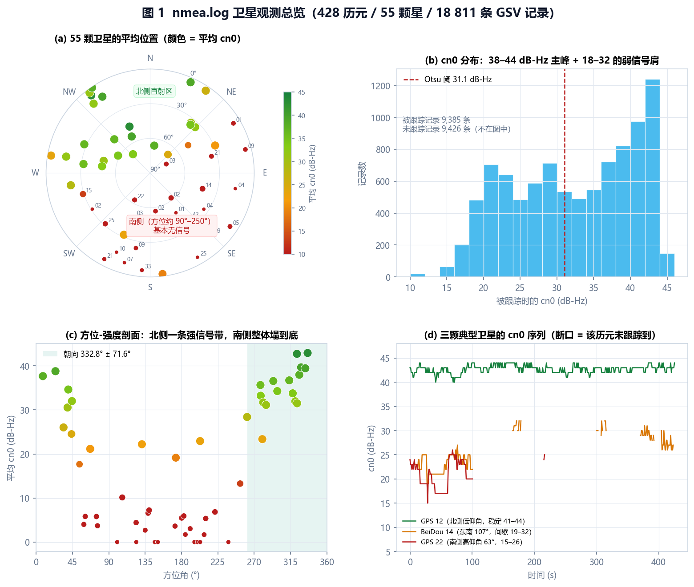

图 1(a) 把 55 颗星按方位/仰角投影到星空图（圆心 = 天顶，圆周 = 地平线）；
颜色是全程平均 cn0，点的大小是跟踪率。

- **北侧**（方位 260°→46°，经北）：一整套 GPS/Galileo/BeiDou/GLONASS 星，平均 cn0 30–43 dB-Hz，
  几乎 100% 被跟踪到。
- **南侧**（方位 47°→260°，经南）：要么完全没有信号（黑色区），要么只有 17–26 dB-Hz 的弱信号、
  且时断时续。
- 图 1(b)：被跟踪样本的 cn0 在 38–44 dB-Hz 有一个主峰，18–32 dB-Hz 是一条宽肩，
  两者之间（约 30 dB-Hz）是天然的谷。
- 图 1(d)：同一颗星在不同时刻的 cn0 会上下跳 10 dB 以上（GPS 22 在 15–26 之间；
  BeiDou 14 在 19–32 之间且有时整段跟踪不到）——**这就是“模型抖动”的来源**，
  也是任务要求用时间窗平滑的原因。

---

## 2. 算法总览

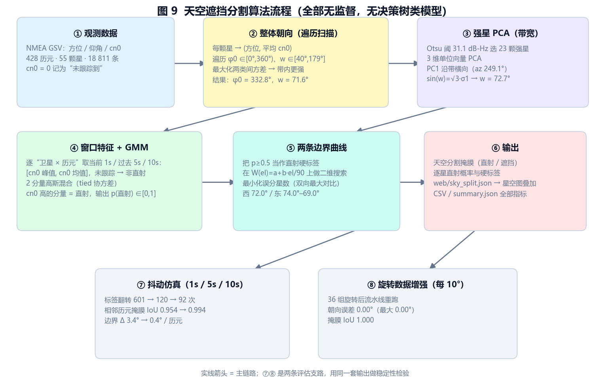

四步主线 + 两条评估支路，全部无监督：

| 步骤 | 输入 | 做法 | 输出 |
| --- | --- | --- | --- |
| ① 观测 | NMEA GSV | 展开成“卫星 × 历元”记录，未跟踪记为 cn0=0 | 18 811 条记录 |
| ② 整体朝向 | 每颗星的平均方位与平均 cn0 | 遍历 (φ0, w)，最大化两类间方差且要求带内更强 | φ0=332.8°，w=71.6° |
| ③ 强星 PCA | Otsu 阈值以上的 23 颗强星 | 3 维单位向量主成分分析，sin(w)=√3·σ1 | w=72.7°，带轴 339.1° |
| ④ GMM 分类 | 1 s / 5 s / 10 s 窗口的 (cn0 峰值, cn0 均值) | 2 分量高斯混合，cn0 高的分量 = 直射 | 逐记录 p(直射)∈[0,1] |
| ⑤ 边界曲线 | 硬标签 + 卫星方位/仰角 | 在 W(el)=a+b·el/90 上做二维搜索，最小化误分星数 | 东/西两条曲线 |
| ⑥ 输出 | 上述结果 | 掩膜、逐星标签、web JSON、CSV | 40.0% 直射面积 |
| ⑦ 抖动仿真 | ④⑤ 换 1 s / 5 s / 10 s 窗口 | 统计翻转率、边界抖动、掩膜 IoU | 见第 8 节 |
| ⑧ 旋转增强 | 方位整体每 10° 旋转一次 | 整条流水线重跑，去旋转后比较 | 见第 9 节 |

**不使用任何决策树类模型**：几何部分是遍历搜索 + 主成分分析 + 二维网格最小二乘，
分类部分是高斯混合模型（EM 拟合的密度聚类），边界部分是加权最大对比割。

### 2.1 坐标约定

- 方位角 `az`：真北 0°，顺时针 0–360°。
- 仰角 `el`：地平线 0°，天顶 90°。
- 星空图半径 `r = 90 − el`：圆心是天顶，圆周是地平线——与网页里的星空图完全一致。
- 带内偏移 `Δ = wrap180(az − φ0) ∈ (−180°, 180°]`，正值在东侧、负值在西侧。

---

## 3. 第一步：遍历扫描找整体朝向

### 3.1 方法

把每颗卫星在整个时段内压成一个点：`(az̄, s)`，其中 `s` 是全程平均 cn0（未跟踪的历元按 0 计，
所以“经常跟踪不到”本身就会把 `s` 压下去）。

对候选中心 `φ0` 与半宽 `w`，定义带内集合 `|Δ| ≤ w`，用**两类间方差**打分：

```
S(φ0, w) = (n_in/n)·(n_out/n)·(m_in − m_out)² ,   约束 m_in > m_out
```

其中 `m_in`、`m_out` 是带内/带外的平均强度。约束很必要：两类间方差对“哪一类在带内”是对称的，
不约束就会同时选出“遮挡带”这个等价解（图 2(a) 里的蓝色区域）。

### 3.2 结果

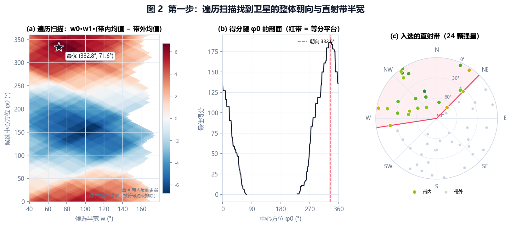

- 最优解 `φ0 = 332.8°`、`w = 71.6°`；由于卫星方位上是离散的，得分在 **329°–337°** 之间完全打平
  （图 2(b) 红色平台），这段区间就是朝向的可辨识精度。
- 入选 24 颗星，最小覆盖弧 **261.2° → 44.4°**（跨 143.2°，中心 332.8°），
  与图 1 里“北侧一条强信号带”的肉眼判断一致。
- 这一步只回答“朝哪边开门、开多宽”，不区分直射/遮挡，所以下一步用 PCA 复核尺度。

---

## 4. 第二步：强星 PCA 求直射带宽度

### 4.1 方法

1. 用**一维 Otsu** 在被跟踪样本的 cn0 上取阈值，得 **31.05 dB-Hz**；
   再要求跟踪率 ≥ 0.85，得到 **23 颗强星**。
2. 把强星映射到 3 维单位球：`v = (cos el·sin az, cos el·cos az, sin el)`，
   去中心后做特征分解，得到 3 条正交主轴与解释方差。
3. 若直射区是一条竖直的带（lune），第一主成分就沿“带的横向”，其标准差 `σ1` 与带的半宽满足
   （带内方位均匀分布时 `E[sin²Δ] = sin²w / 3`）：

```
sin(w) = √3 · σ1
```

### 4.2 结果

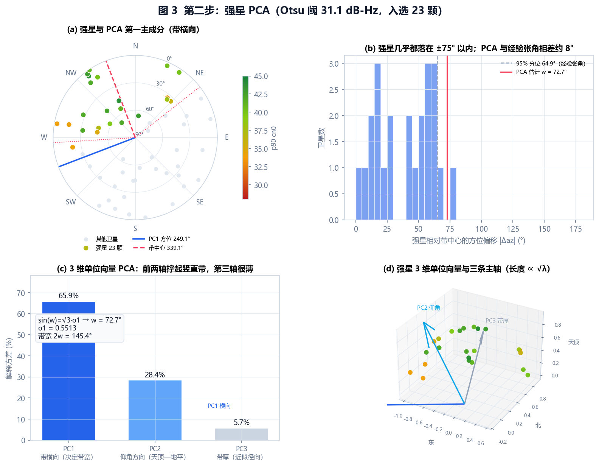

| 主成分 | 解释方差 | 方向 | 含义 |
| --- | --- | --- | --- |
| PC1 | **65.9%** | 方位 249.1°，几乎水平（\|z\|=0.02） | 沿带的**横向**，决定带宽 |
| PC2 | **28.4%** | 天顶—地平方向 | 带内仰角分布 |
| PC3 | **5.7%** | 近似径向 | 带很“薄”，几乎没有离群强星 |

- 由 `σ1 = 0.5513` 得 `w = asin(√3×0.5513) = 72.7°`，**与扫描的 71.6° 只差 1.1°**。
- PC1 的方位 249.1° 加 90° 得到带中心 **339.1°**，与扫描的 332.8° 相差 6.3°。
  这是两种估计的固有差别：PCA 是**密度加权**（强星在西北更密，会把中心往西北拉），
  扫描是**边界等分**。本报告以边界等分（332.8°）为准，PCA 只用于宽度与形状的交叉验证。
- 图 3(b) 里强星相对带中心的方位张角 95 分位是 64.9°、最大值 77.9°，
  与 PCA 的 72.7° 处于同一量级——PCA 给的是“尺度”，不是“边界”，两者不必严格相等。

---

## 5. 第三步：GMM 把每条观测判成直射 / 非直射

### 5.1 特征与窗口

对每条“卫星 × 历元”记录，取当前时刻往前 `Δt` 秒内的同一颗星观测，算两个特征：

| 特征 | 定义 | 物理含义 |
| --- | --- | --- |
| `cn0_peak` | 窗口内 cn0 最大值 | 这段时间里最好的信号质量 |
| `cn0_mean` | 窗口内 cn0 均值（未跟踪记 0） | 有效信号水平，天然包含“跟丢”的比例 |

`Δt ∈ {0 s, 5 s, 10 s}`：0 s 就是“当前 1 s”，5 s / 10 s 是“过去 5 s / 10 s”。

**整窗都没跟踪到的样本不参与聚类**，直接按物理先验判为非直射（`p=0`）：
没有载波就谈不上直射通路。这既符合任务里“没有跟踪到的认为是非直射”，
也避免 50% 的零值把 GMM 的判决面拉偏。

### 5.2 为什么 `track_ratio` 不做独立特征

直觉上“跟踪率”应该是有用特征，但各星座的 GSV 播报节奏不同：GLONASS 每 5 s 才播一次，
它的 `track_ratio` 是在 85 次播报里算的，于是 **GLONASS 66/67/79 这三颗南侧弱星
（平均 cn0 21.1 / 22.2 / 22.9 dB-Hz）的跟踪率高达 0.98**。
把 `track_ratio` 作为第三个维度喂给 GMM，模型会顺着这个维度把“总是被报出来”当成“直射”。

特征消融实验（固定其它设置，只换聚类特征；脚本 `make_sky_report.py --ablation`）：

| 聚类特征 | 与几何直射带的一致率 | 15 颗弱星里被判成直射 |
| --- | --- | --- |
| `cn0_peak` | 0.927 | 0 |
| `cn0_mean` | 0.964 | 0 |
| **`cn0_peak` + `cn0_mean`（采用）** | **0.927** | **0** |
| `cn0_peak` + `cn0_mean` + `track_ratio` | 0.909 | **3**（正是 GLONASS 66/67/79） |

所以最终把“是否跟踪到”折进 `cn0_mean`（未跟踪记 0），而不是单独给它一个维度。

### 5.3 模型

```
p(z) = π_los·N(z; μ_los, Σ) + π_nlos·N(z; μ_nlos, Σ)      # tied 协方差（两分量共享 Σ）
z = [(cn0_peak−m1)/s1, (cn0_mean−m2)/s2]                  # 标准化后聚类
```

- 2 分量、tied 协方差、`n_init=5`、固定随机种子；分量按“cn0 峰值均值”排序，
  高的那个记为直射。
- tied（共享协方差）比 full 更稳：full 协方差会在高度相关的二维特征里找到“跟踪稀疏 vs 密集”
  这种与信号强弱无关的方向，把判决面拧歪。

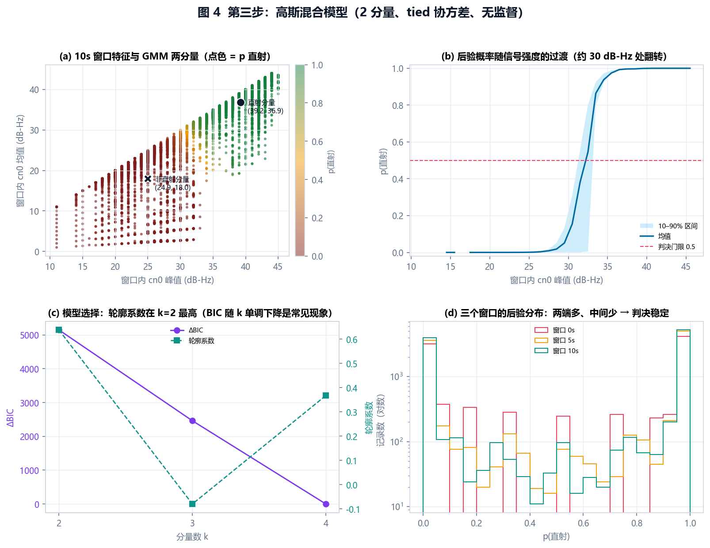

### 5.4 结果

10 s 窗口（主模型）：

| 分量 | cn0 峰值 | cn0 均值 | 权重 |
| --- | --- | --- | --- |
| 直射 | 39.18 | 36.88 | 0.566 |
| 非直射 | 24.95 | 17.96 | 0.434 |

- 判决面大致在 **cn0 峰值 ≈ 31 dB-Hz / cn0 均值 ≈ 27 dB-Hz**，
  图 4(b) 的过渡带（10–90% 分位）落在 30–33 dB-Hz。
- 逐记录直射比例 **31.5%**（在被跟踪到的记录里是 **57.0%**）。
- 模型选择：轮廓系数 k=2 时 **0.638**（k=3 为 −0.08、k=4 为 0.367）；
  BIC 随 k 单调下降是固定样本量下的常见现象，不作为选择依据。
- 与 KMeans(k=2) 的硬标签一致率 **99.6%**——说明结论不依赖具体聚类模型。

---

## 6. 第四步：两条边界曲线

### 6.1 方法

把 `p ≥ 0.5` 当直射硬标签，在“方位-仰角”平面里找两条随仰角缓变的边界：

```
W_side(el) = a + b·(el/90)        # 半宽，正值；side ∈ {西, 东}
直射  ⇔  |wrap180(az − φ0)| ≤ W_side(el)
```

- 为什么不逐仰角带取分位：单侧每个仰角带往往只有 2–5 颗星，分位/割点会被一两颗星拽飞。
- 做法：在 `a ∈ [20,156]`、`b ∈ [−45,45]` 上做二维网格搜索，最小化**误分星数**
  （带内被标为非直射 + 带外被标为直射），并对斜率加一个温和惩罚，证据不足时自动退回直线。
- 先按卫星聚合（一颗星一个点），否则同一颗星在几百个历元里的重复出现会放大权重。
- 不确定度：固定最优斜率，把所有“只多误分 1 颗星”的 `a` 收集起来作为半宽的容差区间。

### 6.2 结果

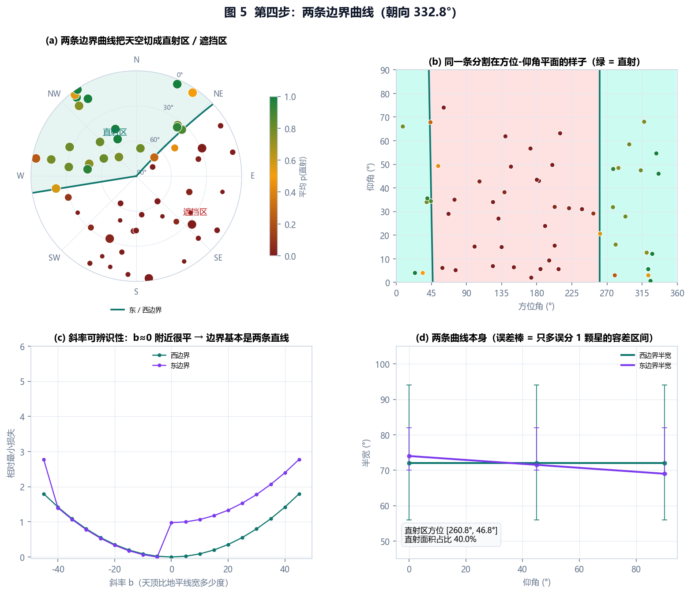

| 边界 | 地平线处半宽 | 天顶处半宽 | 斜率可辨识性 | 误分 | 容差区间 |
| --- | --- | --- | --- | --- | --- |
| 西边界 | **72.0°** | 72.0° | 最优 b=0 | 1/30 | 56°–94° |
| 东边界 | **74.0°** | **69.0°** | 最优 b=−5°/90° | 1.02/25 | 70°–82° |

- 直射区 = 方位 **[260.8°, 46.8°]**，面积占比 **40.0%**（按 `cos el` 加权）。
- 两条曲线基本是两条直线：斜率剖面（图 5(c)）在 b≈0 处有一个很尖的谷，
  说明“建筑遮挡边界在水平面上是一条直墙”这个物理图像和数据是相符的；
  东边界往天顶收窄 5°，对应天际线在低仰角略有压低。
- 图 5(a) 里能看到唯一那颗被误分的星：**BeiDou 28**（方位 280°、仰角 3°、平均 cn0 23.4）
  被模型判成非直射，却被几何带包住——它正好躺在西边界的延长线上，属于“半遮挡”的中间态。
- 图 5(d) 的误差棒说明：**边界位置的分辨率约 ±10–20°**。天空里只有 55 颗星，
  单侧边界附近常年只有 2–4 颗星，这是数据密度的上限，不是算法的问题。

---

## 7. 逐历元的分割结果

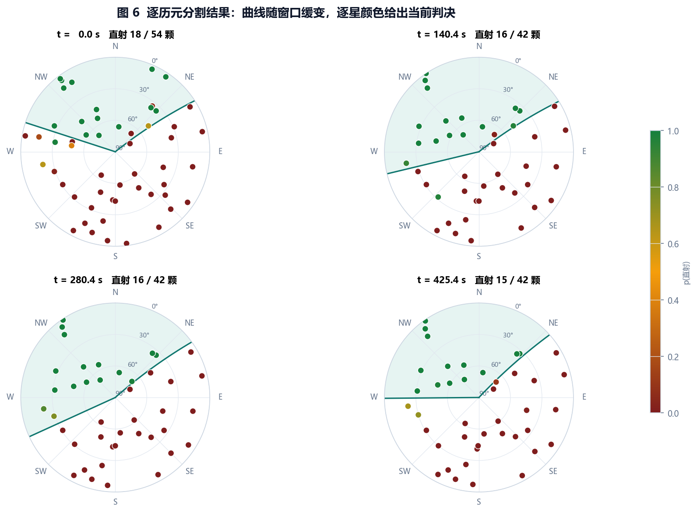

静态环境里天空边界不会每秒变形，所以逐历元只重新估计**整体尺度**：
固定全局曲线形状，用当前窗口内的样本对“归一化偏移 `|Δ|/W(el)`”做一次最大对比割，
得到东西两侧各一个缩放系数 `k_side(t) ∈ [0.6, 1.5]`：

```
W_side(el, t) = k_side(t) · W_side(el)
```

图 6 是 4 个时刻的实拍：曲线在 ±10° 量级内轻微摆动，逐星颜色给出“此刻”的判决，
直射星数在 15–18 之间（该时刻可见 42–54 颗）。

---

## 8. 时间窗仿真：模型抖动有多大

分别用 1 s（当前历元）、5 s、10 s 的窗口重跑分类与逐历元边界：

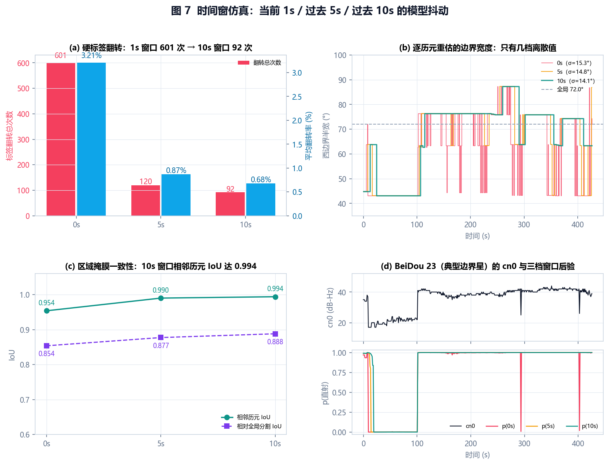

| 指标 | 1 s | 5 s | 10 s | 变化 |
| --- | --- | --- | --- | --- |
| 硬标签翻转总次数 | **601** | **120** | **92** | ↓ 6.5× |
| 平均翻转率（每颗星每次判决） | 3.21% | 0.87% | 0.68% | ↓ 4.7× |
| 翻转率 90 分位 | 8.84% | 3.46% | 2.37% | ↓ 3.7× |
| 边界宽度逐历元变化均值 | 3.30° | 0.71° | **0.41°** | ↓ 8× |
| 边界宽度标准差（最差一侧） | 15.3° | 14.8° | 14.1° | 基本不变 |
| 相邻历元掩膜 IoU | 0.954 | 0.990 | **0.994** | ↑ |
| 相对全局掩膜 IoU | 0.854 | 0.877 | **0.888** | ↑ |
| 直射面积占比（均值） | 37.3% | 38.9% | **39.5%** | 收敛到 40.0% |
| 平均置信度 \|p−0.5\|×2 | 0.950 | 0.965 | **0.969** | ↑ |

三个结论：

1. **标签抖动是时间窗的函数**：601 → 120 → 92 次翻转，图 7(a) 的柱状图非常直观。
   图 7(d) 是翻转最典型的 BeiDou 23：1 s 窗口下它的后验在 0/1 之间反复横跳，
   10 s 窗口把它压成一条几乎平的线。
2. **区域抖动只在 1 s 窗口明显**：相邻历元 IoU 从 0.954 提到 0.994，
   边界宽度的逐历元变化从 3.3° 降到 0.4°。
3. **边界宽度的标准差降不下去**（15.3° → 14.1°）：这不是时间窗不够长，而是**卫星几何太稀**。
   单侧边界附近只有两三颗星，割点只能落在星与星之间的空隙里，宽度天然是“几档离散值”
   （图 7(b) 的台阶），一颗边界星翻转就会让边界跳 10–20°。要压下去只能换更稳的估计
   （例如用全局曲线做形状先验，本报告第 7 节就是这么做的）。

---

## 9. 旋转数据增强：每 10° 转一次

把全部卫星的方位角整体加 β（β = 0°, 10°, …, 350°，共 36 组），整条流水线重跑，
再把结果旋转回基准比较：

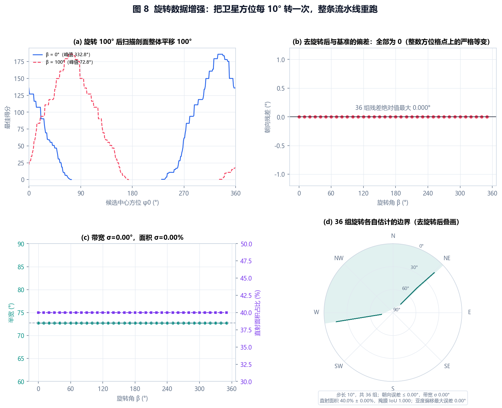

| 指标 | 36 组结果 |
| --- | --- |
| 朝向误差 `wrap(φ0(β) − β − φ0(0))` | 均值 0.00°，最大 0.00° |
| 直射带半宽（PCA） | 72.72° ± 0.00° |
| 直射面积占比 | 40.01% ± 0.00% |
| 去旋转后掩膜 IoU | 1.000（最小 1.000） |
| 两条边界曲线去旋转后的偏差 | 0.00° |
| 卫星硬标签一致率 | 100%（分类只用信号特征，与方位无关） |

- 图 8(a) 把旋转 0° 与 100° 的扫描剖面画在一起：整条曲线正好平移 100°，峰值从 332.8° 到 72.8°。
- 图 8(d) 是 36 组各自估计的边界去旋转后叠画，完全重合。
- 严格等变不是“整数格点对齐”的巧合：NMEA 的方位角本身是整数度，10° 旋转把格点映到格点上。
  为了排除这种可能，额外做了**亚度偏移检验**（β = 0.37°、1.71°、3.14°、6.28°）：
  朝向误差仍为 **0.00°**，半宽偏差最大 **0.003°**。
  原因是朝向估计最后落在“带内卫星的最小覆盖弧中心”，这一步与格点无关。

**这说明算法没有方向偏置**：无论建筑朝向转到哪，输出都只是整体平移，尺度与掩膜不变。

---

## 10. 无标签校验

没有真值，但有三类“几乎确定”的样本可以校准：

| 校验 | 样本 | 期望 | 实测 |
| --- | --- | --- | --- |
| 全时段从未跟踪到（cn0 恒为 0） | 8 颗 | p≈0 | 平均 p = **0.0000**，全部判非直射 |
| 全时段强信号（cn0 ≥ 30 且跟踪率 100%） | 6 颗 | p≈1 | 平均 p = **0.9962**，99.9% 判直射 |
| 两类极值合计 | 14 颗 × 428 历元 | — | 准确率 **99.98%** |
| 方位象限的平均 p(直射) | — | 北高南低 | 北 **0.850**、西 0.579、东 0.100、南 **0.006** |
| 信号判决与几何分割的不一致率 | 全部记录 | 应较低 | **9.4%** |

最后一行是“信号证据”和“几何先验”的融合一致性：两者独立得到，
只有 9.4% 的观测落在对方的另一边，且集中在边界附近（BeiDou 28/34、GPS 11/17 等）。

---

## 11. 可视化叠加（可选）

`sky_split.py` 只负责导出 `out/sky_split.json`（约 386 KB）。独立查看器可以读取这份数据，
在星空图上按当前时刻叠加：

- **青色扇区** = 直射带（两条边界曲线 + 地平线弧围成的区域）；
- **实线** = 当前 10 s 窗口估计的两条边界，**灰色点线** = 全程估计；
- **红圈** = 有载噪比但被判为非直射（p<0.5）的卫星——最值得人工复核的那一类；
- 鼠标悬停会显示该星的 p(直射)；
- 面板右上角的“遮挡分割”开关可以随时关掉叠加；如果打开的文件与 JSON 历元数不一致，会自动关闭并提示。

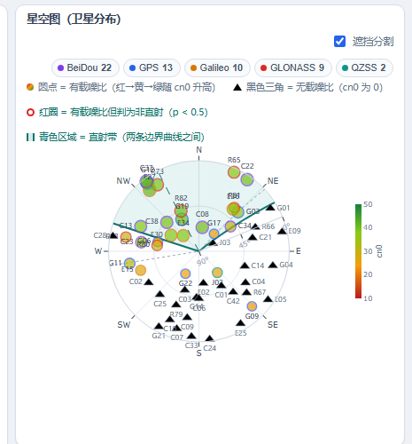

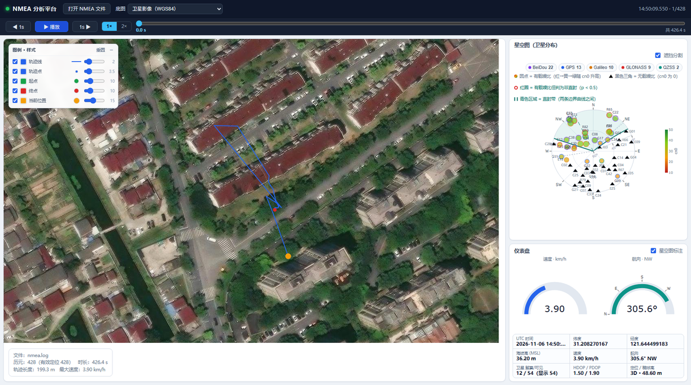

导出方式：

```bash
python sky_split.py          # 生成 out/sky_split/* 与 out/sky_split.json
```

---

## 12. 复现

```bash
# 1) 解析 + 分割 + 抖动 / 旋转实验（约 10 s）
python sky_split.py --print

# 2) 生成报告插图（约 15 s）与特征消融
python make_sky_report.py --ablation

# 3) 测试
python -m unittest discover -s tests -v
```

依赖：`numpy`、`scikit-learn`、`matplotlib`（画图用）。解析部分仍然只用标准库。

产物：

| 文件 | 内容 |
| --- | --- |
| `out/sky_split/summary.json` | 全部关键指标（朝向、PCA、曲线、分类、抖动、旋转、校验） |
| `out/sky_split/satellites.csv` | 55 颗星的方位/仰角/强度/跟踪率/p(直射)/标签 |
| `out/sky_split/labels.csv` | 18 811 条观测的窗口特征、p(直射)、硬标签 |
| `out/sky_split/curves.csv` | 两条边界曲线（半宽与方位） |
| `out/sky_split/feature_ablation.json` | 特征消融表 |
| `out/sky_split.json` | 可视化导出数据（逐历元曲线 + 逐星概率） |
| `docs/sky/*.png` | 本报告全部插图 |

---

## 13. 局限与可以继续做的

1. **边界分辨率受限于卫星数量**。55 颗星在单侧边界附近只有 2–4 颗，半宽的容差区间宽达 ±20°。
   如果有多频/多系统原始观测（或更长时段），边界会细得多。
2. **PCA 宽度是密度加权尺度**，近似的 `sin(w)=√3σ` 假设带内方位均匀；
   本数据实测 72.7°（PCA）vs 71.6°（扫描边界）相差 1.1°，但不能保证在别的场景也这么接近。
   报告里始终以边界等分作为最终朝向。
3. **“弱信号 = 非直射”是物理假设**。遇到窄缝里的间歇直射（BeiDou 34 这类 55% 跟踪率、
   峰值 34 dB-Hz 的星）时，模型会在 p≈0.44 附近给一个“说不准”的答案，这是诚实的，
   但也意味着这类样本的标签会随时间窗抖。
4. **逐历元只估尺度**。这是为了换取稳定性的工程取舍；如果环境本身在变（例如车辆行驶中
   建筑轮廓变化），应该改成“形状也随时间慢变”的状态空间模型。
5. **未使用多径/多普勒/高度角速率等额外证据**。这些信息能进一步区分
   “被挡但仍被跟踪”和“真的直射”，属于后续工作。
